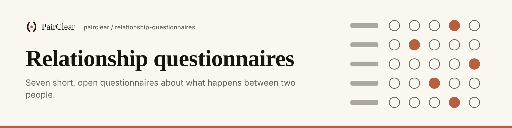
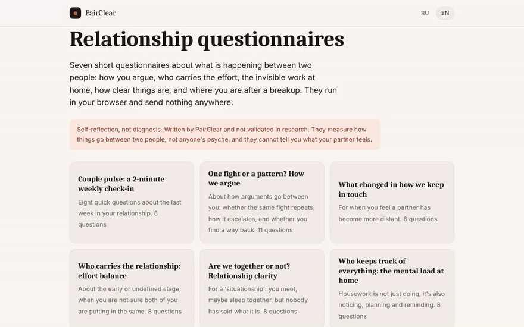

<a href="https://pairclear.github.io/relationship-questionnaires/"><picture>
  <source media="(prefers-color-scheme: dark)" srcset="assets/banner-dark.png">
  
</picture></a>

# Relationship questionnaires: free, open, and in your browser

**[Take one now →](https://pairclear.github.io/relationship-questionnaires/)** · [Русская версия](README.ru.md) · [Data (JSON)](data/questionnaires/) · [Claude skill](SKILL.md) · [Licence check of validated scales](docs/licence-check.md)

     

> **Self-reflection, not diagnosis.** These questionnaires are written by PairClear and are not validated in research. They look at what happens between two people, not at anyone's psyche, and they cannot tell you what your partner feels. If you are afraid of your partner, are being threatened or controlled, or are thinking about hurting yourself, call emergency services (112 in Europe, 911 in the US and Canada) or find a free helpline at [findahelpline.com](https://findahelpline.com).

## See it in action

**[Try it in your browser →](https://pairclear.github.io/relationship-questionnaires/?lang=en)** No install, nothing is sent anywhere.

Seven short questionnaires (8 to 11 statements each) with open data, a scoring rule anyone can check, and a page that runs entirely in your browser.

## The questionnaires

| Questionnaire | What it looks at | Parts | Printable |
|---|---|---|---|
| Couple pulse | A 2-minute weekly check-in | Connection, friction | [EN](questionnaires/couple-pulse.en.md) · [RU](questionnaires/couple-pulse.ru.md) |
| One fight or a pattern? | How arguments go | Repeating loop, escalation, repair (+2 safety questions) | [EN](questionnaires/conflict-pattern.en.md) · [RU](questionnaires/conflict-pattern.ru.md) |
| What changed in how we keep in touch | When a partner seems more distant | Change in contact, how much it takes from me | [EN](questionnaires/contact-changes.en.md) · [RU](questionnaires/contact-changes.ru.md) |
| Who carries the relationship | Early or undefined stage | Imbalance of effort, clarity | [EN](questionnaires/effort-balance.en.md) · [RU](questionnaires/effort-balance.ru.md) |
| Are we together or not? | A "situationship" | Clear signals, what the uncertainty costs me | [EN](questionnaires/relationship-clarity.en.md) · [RU](questionnaires/relationship-clarity.ru.md) |
| Who keeps track of everything | Mental load at home | My share of invisible work, can we talk about it | [EN](questionnaires/mental-load.en.md) · [RU](questionnaires/mental-load.ru.md) |
| After the breakup: where am I now | Weeks or months after | Still holding on, coming back to my life | [EN](questionnaires/after-breakup.en.md) · [RU](questionnaires/after-breakup.ru.md) |

## How scoring works

Every statement is answered on the same scale: 0 Never, 1 Rarely, 2 Sometimes, 3 Often, 4 Almost always. Items marked `"rev": true` are reversed (4 minus the answer). Each part is the average of its items, from 0 to 4. Under 1.5 is shown as low, 1.5 to 2.5 as middle, above 2.5 as high, each with a short text about what might be worth talking about.

These bands are not norms or clinical cut-offs. Nobody has collected data on these questions yet, so a "high" score only means you answered "often" a lot. Two questions in "One fight or a pattern?" are about safety: they are not scored, and if either is answered "sometimes" or more, the result shows where to get help first.

## Why we wrote our own questions

We wanted to publish well-known validated scales, translated and free. We checked eight of them on 2026-11-26 (Couples Satisfaction Index, its German CC BY version, ECR-R, ECR-RS, Relationship Assessment Scale, M-QoRS, Dyadic Adjustment Scale, Gottman questionnaires). None had terms that clearly allow anyone to republish, translate and use the items commercially: most are "free for research", some need permission or are sold. Details and sources: [docs/licence-check.md](docs/licence-check.md).

So these questions are ours, under CC BY 4.0, and honestly labelled as not validated. If you are a researcher and want to validate or adapt them, you can.

## For developers

- `data/questionnaires/<id>.json`: one file per questionnaire, items in EN and RU, subscales, band texts, reflection questions, links. `data/questionnaires.json` is the bundle of all seven.
- `python3 build.py` checks the data (every part has at least 3 items, every text has both languages) and regenerates the Markdown, the bundle and `index.html`.
- `index.html` is one file with no dependencies and no network requests. Open `?q=conflict-pattern&lang=en` to go straight to one questionnaire.

## FAQ

**Can I use these with clients?** Yes, as conversation starters. Don't use them as an assessment instrument: they are not validated.

**Can my partner and I both fill one in?** Yes, that's the best way. Fill it in separately, then compare part by part and talk about the biggest difference.

**Can it tell me if my partner is losing interest?** No questionnaire you fill in alone can. "What changed in how we keep in touch" shows what you've observed and how much it takes from you; the rest is a conversation.

**Where are the answers stored?** Nowhere. The page keeps them in memory and forgets them when you close the tab.

## Related

- [PairClear quizzes](https://pairclear.com/en/tests/?utm_source=github&utm_medium=readme&utm_campaign=relationship-questionnaires): [Am I the problem?](https://pairclear.com/en/tests/am-i-the-problem/?utm_source=github&utm_medium=readme&utm_campaign=relationship-questionnaires), [Is she losing interest?](https://pairclear.com/en/tests/is-she-losing-interest/?utm_source=github&utm_medium=readme&utm_campaign=relationship-questionnaires), [Will she come back?](https://pairclear.com/en/tests/will-she-come-back/?utm_source=github&utm_medium=readme&utm_campaign=relationship-questionnaires)
- [Not a therapist](https://github.com/pairclear/not-a-therapist): safety rules for AI chats about relationships
- [16 associations](https://github.com/pairclear/sixteen-associations): a self-reflection exercise in the browser

## Contributing

Translations are welcome: add a language key next to `en` and `ru` in each JSON and in `T` inside `src/template.html`, then run `python3 build.py`. Please keep the "not validated" and safety texts.

## More free tools from PairClear

| Repo | What it is |
|---|---|
| [16 associations](https://github.com/pairclear/sixteen-associations) | Write 16 words about one topic and merge them in pairs down to one |
| [Psychology lenses](https://github.com/pairclear/psychology-lenses) | One situation through Freud, Jung, CBT and 5 more schools |
| [Reflection journal](https://github.com/pairclear/reflection-journal) | Questions after a fight, before a hard talk, weekly check-in |
| [Thoughts after a fight](https://github.com/pairclear/conflict-thought-diary) | A CBT thought diary for conflicts with a partner |
| [Not a therapist](https://github.com/pairclear/not-a-therapist) | Safety rules for AI chats about relationships |
| [Couples counselling kit](https://github.com/pairclear/couples-counseling-kit) | Templates, homework and AI prompts for practitioners |

All tools and articles: [pairclear.com](https://pairclear.com/en/?utm_source=github&utm_medium=readme&utm_campaign=relationship-questionnaires) · [github.com/pairclear](https://github.com/pairclear)

## Licence

Code (`build.py`, `index.html`, `src/`): [MIT](LICENSE). Questionnaires, texts and data: [CC BY 4.0](LICENSE-TEXT.md). Written with AI assistance.
